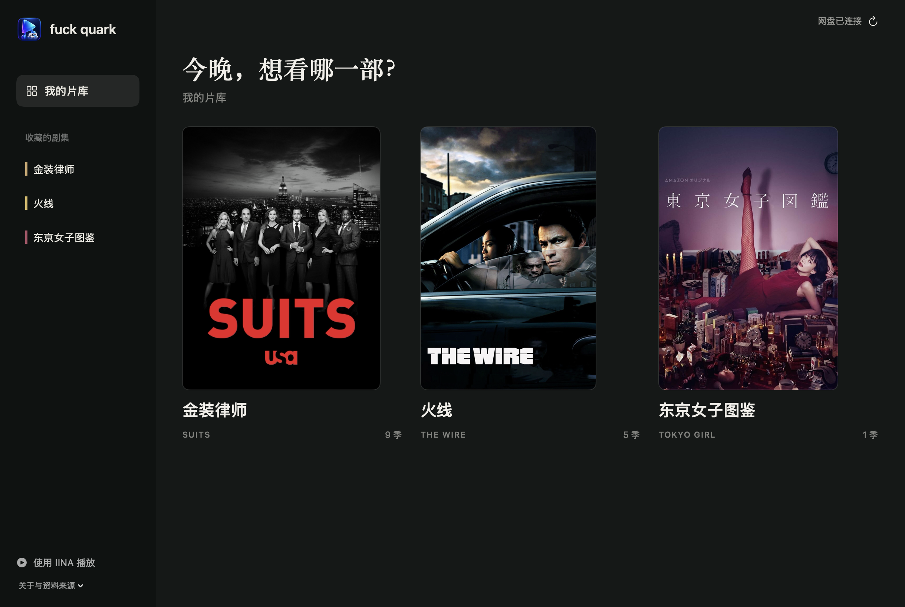
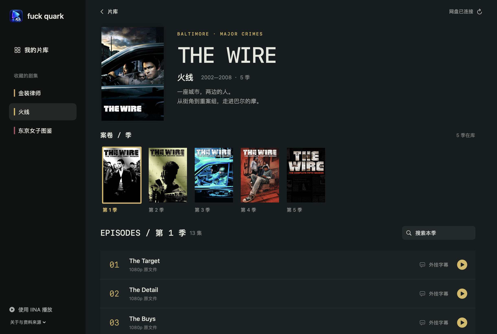

# fuck quark

**把夸克网盘接到 Mac，用 IINA 播放原文件。**

不想每次看剧都翻一长串文件名，也不想围着网页播放器的会员档位转。所以有了这个私人影院：打开片库、点海报、选一季，再点一集就播。署名：`xing0325/fuckquark`。



## 已经能做什么

- 在本机启动只读 WebDAV 服务，访问自己的夸克网盘。
- 把原文件交给 IINA 流式播放，不必先下载完整一集。
- 按剧、季、集浏览，搜索当前季，记录最近打开的剧集。
- 匹配同目录的外挂字幕；视频加载后自动加载并选中字幕。
- 原生 SwiftUI 界面，目前内置《金装律师》《火线》《东京女子图鉴》三部剧的展示配置。



## 怎么连接

**夸克网盘 → quarkdrive-webdav（本机）→ fuck quark 片库 → IINA**

当前界面通过本地 HTTP/WebDAV 地址播放，不依赖 Finder 挂载卷，避免旧版本 Finder 挂载的兼容问题。它不会把网盘全部同步到硬盘。

## 画质测试

同一份《火线》S01E01，在一次账号与网络环境下的结果：

| 播放路径 | 视频分辨率 | 视频流帧率 |
| --- | --- | --- |
| 本项目 / 原文件 | 1920 × 1080 | 标称 23.976 fps |
| 夸克网页接口默认返回的转码版本 | 1440 × 810 | 抽样解码 23.976 fps |

原片下载约五分钟后进行了本地解码验证，临时视频已删除。网页转码样本和原片都约 24 帧。此测试没有测量浏览器播放过程中的丢帧，也没有验证 SVIP 的 60 帧功能；不能据此认定平台故意降帧。实际画质、帧率与流畅度仍取决于原文件、网络及设备。

## 在自己的 Mac 上运行

**目前是开发者预览，没有开箱即用的安装包。** 已在作者的 Apple Silicon Mac 上验证；其他 macOS 版本与 Intel Mac 尚未验证。首次配置仍需自己取得夸克登录 Cookie。

1. 安装 [IINA](https://iina.io/) 到 `/Applications/IINA.app`，安装 Xcode Command Line Tools 和 Python 3。
2. 从 [quarkdrive-webdav](https://github.com/chenqimiao/quarkdrive-webdav) 官方 Releases 下载适合本机架构的二进制，按上游说明赋予执行权限。项目测试使用 v1.3.9。
3. 在夸克里准备一个影视根目录，其中的剧名文件夹包含“金装”“火线”或“东京女子”。分季文件夹可采用 `Season 1`、`S01` 等名称；外挂字幕和视频保持同目录、同文件名主体。
4. 克隆源码并执行：

```bash
git clone https://github.com/xing0325/fuckquark.git
cd fuckquark
python3 scripts/configure.py
bash scripts/build.sh /你保存的位置/quarkdrive-webdav
open "build/fuck quark.app"
```

配置脚本询问影视根目录和 Cookie，输入 Cookie 时不会显示。数据仅写入本机 `~/Library/Application Support/QuarkCinema`。若升级旧版本，会保留现有 WebDAV 密码。Cookie 过期后重跑配置并重启本地后端。

构建需要 Swift 编译器与 SDK 匹配。如果默认 SDK 不兼容，可以使用 `SDKROOT=/本机已安装的兼容SDK路径 bash scripts/build.sh /后端路径`。本仓库只做本地 ad-hoc 签名，未提供 Apple 公证发行包。

## 还没做好

- 首次登录向导、通用安装包和另一台 Mac 的完整安装验证。
- 任意影视库的自动识别。目前三部剧的配置位于 `Sources/QuarkCinema.swift` 的 `Series.all`。
- 播放进度同步。当前“最近观看”记录的是打开记录，不是跨设备进度。

## 项目组成与致谢

- [quarkdrive-webdav](https://github.com/chenqimiao/quarkdrive-webdav)：连接夸克网盘，本项目启动其独立进程。
- [IINA](https://github.com/iina/iina)：播放原文件，通过 mpv IPC 加载外挂字幕。
- SwiftUI / AppKit：片库、剧集页面和本机应用。
- TVmaze：剧集元数据与海报来源，记录见 `Resources/posters/sources.json`。海报、剧名和商标属于各自权利人；本项目不提供影视文件或分享链接。

账号 Cookie、密码、播放列表、观看记录不属于项目源码，不应提交到仓库。WebDAV 只监听 `127.0.0.1:18080`，启用独立密码并以只读模式运行。
